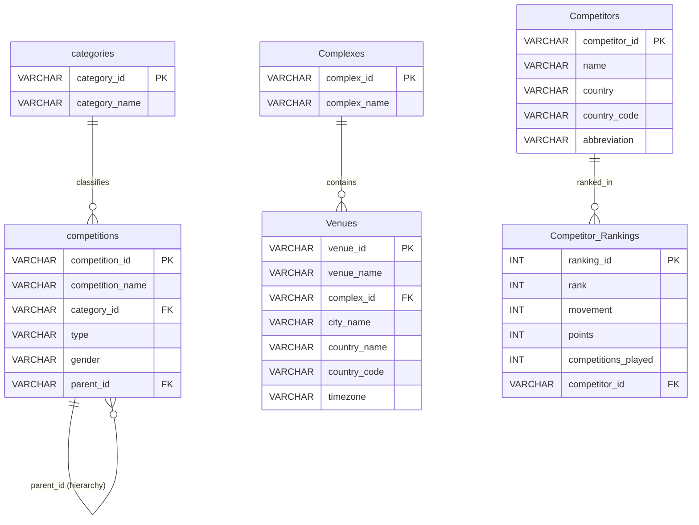

# 🎾 Game Analytics: Unlocking Tennis Data with Sportradar API

**Domain:** Sports & Data Analytics  
**Tools & Technologies:** Python, Sportradar API, Relational SQL (MySQL & SQLite), Streamlit, Plotly, Pandas, SQLAlchemy  

---

## 👥 Team Roles & Responsibilities

| Team Member | Role | Key Contributions |
| :--- | :--- | :--- |
| **Ashish** | **Data Extraction (API Layer)** | • Ingested data from 3 Sportradar Tennis API endpoints: Competitions, Complexes, and Doubles Competitor Rankings.<br>• Parsed nested JSON structures into normalized, tabular objects.<br>• Managed rate limiting (429 handling) and data cleaning. |
| **Nithish** | **SQL Database (Schema & Queries)** | • Designed relational database schema across 6 core tables with Primary & Foreign Key constraints.<br>• Formulated, tested, and cataloged all 20 required analytical SQL queries.<br>• Provided schema definitions and analytical query logic in `Game Analytics.sql`. |
| **Dibya** | **Streamlit App & BI Dashboard** | • Developed interactive, multi-page Streamlit analytics dashboard.<br>• Engineered dual-backend live SQL connectivity (MySQL 9.7 & portable SQLite replica).<br>• Implemented dynamic search/filters, tournament hierarchy trees, player comparison cards, country choropleth maps, and an interactive SQL Query Studio. |

---

## 🗄️ Relational Database Schema

The database consists of **6 interrelated tables** capturing the complete tennis competition hierarchy:



---

## 📋 The 20 Required SQL Queries

All 20 queries from `Game Analytics.sql` are integrated into the live dashboard and tested across both engines:

### 🏆 Competitions & Categories
1. **Query 1:** List all competitions along with their category name.
2. **Query 2:** Count the number of competitions in each category.
3. **Query 3:** Find all competitions of type 'doubles'.
4. **Query 4:** Get competitions that belong to a specific category (e.g., *ITF Men*).
5. **Query 5:** Identify parent competitions and their sub-competitions (*Hierarchy Analysis*).
6. **Query 6:** Analyze the distribution of competition types by category.
7. **Query 7:** List all competitions with no parent (*Top-Level Competitions*).

### 🏟️ Complexes & Venues
8. **Query 8:** List all venues along with their associated complex name.
9. **Query 9:** Count the number of venues in each complex.
10. **Query 10:** Get details of venues in a specific country (e.g., *Chile*).
11. **Query 11:** Identify all venues and their timezones.
12. **Query 12:** Find complexes that have more than one venue (*Multi-Court Facilities*).
13. **Query 13:** List venues grouped by country.
14. **Query 14:** Find all venues for a specific complex (e.g., *Nacional*).

### 🎾 Competitors & Rankings
15. **Query 15:** Get all competitors with their rank and points.
16. **Query 16:** Find competitors ranked in the top 5.
17. **Query 17:** List competitors with no rank movement (*Stable Rank*).
18. **Query 18:** Get the total points of competitors from a specific country (e.g., *Croatia*).
19. **Query 19:** Count the number of competitors per country.
20. **Query 20:** Find competitors with the highest points in the current week (*World #1*).

---

## 🚀 How to Run the Application

### 1. Initialize / Refresh the Database
To populate both your local **MySQL Server** (`tennis_analytics`) and generate the portable **SQLite database** (`tennis_analytics.db`), execute:
```bash
python setup_database.py
```

### 2. Launch the Streamlit Dashboard
Launch the interactive web application:
```bash
streamlit run app.py
```
The app will automatically open in your default browser at `http://localhost:8501`.

---

## 🖥️ Streamlit Dashboard Modules (Built by Dibya)

1. **🏠 Executive Overview:** Real-time KPI banner, tournament format donut charts, and high-level circuit summaries.
2. **🔍 Tournament Explorer:** Multi-criteria filter system (Category, Format, Gender, Search) and tournament parent-child hierarchy visualizer.
3. **🏟️ Venues & Complexes:** Global court infrastructure explorer with dedicated Chilean venue deep dive (Q10) and timezone coverage analysis (Q11).
4. **🎾 Competitor Profiles:** Interactive player cards, status badges (Rising, Falling, Stable), and side-by-side head-to-head comparison tool.
5. **🌍 Country Analytics:** Croatia ranking points spotlight (Q18), nation talent count (Q19), and worldwide interactive choropleth map.
6. **🏆 Doubles Leaderboards:** Podium showcase for World #1 (Q20), Top 5 ranking board (Q16), and points vs. rank correlation scatter plots.
7. **⚡ Live SQL Query Studio:** Run any of the 20 pre-configured queries with execution timer, auto-generated charts, CSV export, or execute custom ad-hoc `SELECT` queries.
